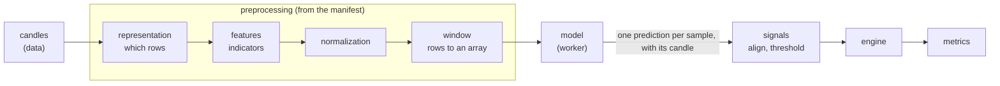

# Preprocessing and the model manifest

A trained model is a function from one input array to one output. The file says only the shape
of that array (`[None, 25, 23]`), never what is in it: which indicators, with which parameters,
normalized how, sampled when, in which column order. Feed it the wrong columns in the right
shape and it answers anyway, with numbers that look real. This document is the contract that
prevents that: the **manifest** stored with every model, and the `preprocessing` module that
turns candles into the model's input from it. It is the design agreed on 2026-10-18; nothing of
it is built yet. Architecture and module rules: [architecture.md](architecture.md). The backtest
that consumes the predictions: [engine.md](engine.md).

## Where it sits



- Every step is a block from a catalog, chosen and configured by the manifest. A new kind of
  preprocessing is a new block; the steps around it, the model runners and the engine stay as
  they are.
- Every sample knows the candle at whose close it was known. Its prediction goes back to that
  candle, so the engine keeps getting what it takes now: candles with one signal each.

## The manifest

A JSON document stored with each model (a JSONB column of `models`). A model uploaded without
one is kept but cannot run (`needs_setup`) until its manifest is added. Each backtest stores a
copy of the manifest it ran with, next to the model's SHA-256, so a later change to the
manifest never rewrites what an old backtest means.

No existing standard describes Renko bricks, indicator windows and column order, so the schema
is our own (`candlestack.manifest/1`, a JSON Schema in the repository). It borrows from:

| Standard | What we take |
| --- | --- |
| MLflow model signature | the input and output shape, dtype and column names; an input example with its expected output |
| Hugging Face `preprocessor_config.json` | one document next to the weights that fully describes the input |
| Qlib data handler config | the features and the processing steps as data, each a catalog name plus parameters |
| Model Cards | what the model was trained on and when, for people |

### Fields

| Field | Meaning |
| --- | --- |
| `schema` | `candlestack.manifest/1` |
| `input.timeframe`, `input.session` | the candles the model expects: `30m`, `regular` (US trading hours) |
| `input.representation` | which rows the model sees: a catalog block and its parameters (`candles@1`, `renko@1`, ...) |
| `input.features` | the columns in their exact order: each a name, a catalog block (`rsi@1`), its parameters and its normalization |
| `input.window` | how many rows make one sample, and the rule for the last one |
| `signature.input`, `signature.output` | shape and dtype; must equal what the model file says |
| `signature.output.meaning` | `score`: the sign is the direction, the size is compared with the threshold |
| `example` | optional: a small input with the output the model must give for it |
| `about` | free text for people: trained on which instruments, which period, notes |

Catalog names carry a version (`aroon@1`): one indicator name gives different numbers in
different libraries and versions (the supervisor's Aroon, Keltner and OBV differ from
`ta` 0.11's, [research #118]), so a manifest names our exact implementation, never "Aroon".

### Example: no preprocessing

The first blocks, with which the whole chain is built and tested: every candle is a row, the
features are the raw prices, nothing is normalized, a sample is the last 25 candles.

```json
{
  "schema": "candlestack.manifest/1",
  "input": {
    "timeframe": "30m",
    "session": "regular",
    "representation": {"id": "candles@1"},
    "features": [
      {"name": "open", "id": "open@1", "norm": {"id": "none@1"}},
      {"name": "high", "id": "high@1", "norm": {"id": "none@1"}},
      {"name": "low", "id": "low@1", "norm": {"id": "none@1"}},
      {"name": "close", "id": "close@1", "norm": {"id": "none@1"}},
      {"name": "volume", "id": "volume@1", "norm": {"id": "none@1"}}
    ],
    "window": {"length": 25}
  },
  "signature": {
    "input": {"shape": [25, 5], "dtype": "float32"},
    "output": {"shape": [1], "dtype": "float32", "meaning": "score"}
  },
  "about": {"note": "Test model for the pipeline"}
}
```

### Example: the supervisor's NO-VOL models (25 x 23)

What the same schema says for his models, as far as we know his pipeline
([research #117]): indicators on the 30-minute candles, Renko bricks of 0.6 x ATR(14) of the
brick's first candle, rows of three bricks taken at the candle where the third one ends, a
window of the last 24 finished rows and the current one. It cannot run yet: his normalization
formulas are not known.

```json
{
  "schema": "candlestack.manifest/1",
  "input": {
    "timeframe": "30m",
    "session": "regular",
    "representation": {
      "id": "renko-triples@1",
      "params": {"atr_multiple": 0.6, "atr_window": 14, "atr_at": "brick_start"}
    },
    "features": [
      {"name": "bb_bbh", "id": "bollinger-high@1", "params": {"window": 20, "dev": 2}, "norm": {"id": "supervisor@1"}},
      {"name": "rsi", "id": "rsi@1", "params": {"window": 20}, "norm": {"id": "supervisor@1"}},
      {"name": "direction", "id": "renko-direction@1"}
    ],
    "window": {"length": 25, "last": "current"}
  },
  "signature": {
    "input": {"shape": [25, 23], "dtype": "float32"},
    "output": {"shape": [1], "dtype": "float32", "meaning": "score"}
  },
  "about": {"trained_on": "S&P 500 stocks", "period": "2016-01-07..2022-12-30"}
}
```

The features are shortened here: the real list has all 23 in the order of research #117,
`bb_bbh, bb_bbl, kch_high, kch_low, squeeze, rsi, roc, tsi, atr, adx, aroon_up, aroon,
aroon_down, sma, ema20, ema50, macd_diff, direction, rel_open, rel_high, rel_low, rel_close,
is_last_bar`.

### What the user chooses

| Fixed by the manifest | Chosen for each backtest |
| --- | --- |
| timeframe, representation, brick size, features and their order, indicator parameters, normalization, window | instruments, period, the post-processing (threshold, long only, stop loss, later smoothing, holding period, sizing), fees, slippage, fill, benchmark |

A trained model only works on the input it was trained on, so the builder shows the manifest's
input as read only. Comparing Renko with Kagi, or one architecture with another (TSMixer,
StockMixer, the supervisor's MLP), means comparing backtests of models trained on each, on the
Compare page, not a step of the builder. A mode that lets a user change inputs of a trained
model (say a brick of 0.2 instead of 0.6 x ATR) is left out for now; catalog parameters carry a
`tunable` flag from the start, so it can be added without changing the schema.

### The builder

The model comes first, because it fixes the most: the timeframe, the session and the whole
input.

| Step | What happens |
| --- | --- |
| 1. Model | one of the user's models, or Upload model, which opens the upload below and comes back with the new model chosen; models without a manifest are shown but cannot be chosen ("needs a manifest") |
| 2. Data | instruments and period; the timeframe is the model's. What cannot work is disabled with the reason, such as an instrument without candles for the period and the warm-up |
| 3. Preprocessing | the manifest's input, read only: "Renko 0.6 x ATR · 23 features · window 25", with the full list on demand |
| 4. Post-processing | threshold, long only, stop loss, later smoothing, holding period, sizing; free to choose |

### The upload

The model and its manifest are two files, `model.keras` (or `model.onnx`) and `manifest.json`;
both can be dropped at once, and the app tells which is which.

1. The model file: its check reads the input shape (`[25, 23]`).
2. How to feed it, one of: upload `manifest.json`; pick a template ("Supervisor NO-VOL
   25 x 23", "Raw candles 25 x 5"); or build it in a form from the catalog (blocks, order,
   window). The shape is compared at once: "the manifest gives [25, 23], the model takes
   [25, 23]".
3. An example input with its output, optional: the model is `verified` when it matches.
4. Save. Step 2 can be skipped: the model is kept as `needs_setup`, and its manifest is added
   later from the Models page.

## The blocks

Every block is a plain function on Polars frames, like the backtest modules: it imports no
other module of the project and no server library. It is registered in the catalog under its
versioned name, with a Pydantic model of its parameters, its warm-up (how many earlier candles
it needs) and a short description. `GET /api/v1/preprocessing/catalog` serves the catalog, so
the app builds its forms from it and a new block needs no frontend change.

| Step | In, out | Blocks, in the order they come |
| --- | --- | --- |
| representation | candles, rows: each row with `ts`, the candle at whose close it is known, and the row's own columns | `candles@1` (every candle a row); then `renko-triples@1`, `kagi@1`; later Heikin-Ashi, range bars, volume bars |
| features | rows, the same rows with one column per feature, computed on the candles (later optionally on the bricks) | `open@1` ... `volume@1`; then the supervisor's indicators |
| normalization | a column, the column scaled | `none@1`; then the supervisor's formulas, a rolling z-score, price-relative; fitted numbers come only from the manifest, never from the backtest's own data |
| window | rows, an array `(samples, length, features)` and the `ts` of each sample | the last `length` rows up to each candle; `last: current` adds the row still forming |

- With `candles@1` every candle has a sample. With an event representation (Renko, Kagi) a
  candle without a new row repeats the last prediction: `signals.align(strict=False)` does
  this already ([engine.md](engine.md#signals)), so the signal holds and no order follows.
- Warm-up: the run asks the data module for enough candles before the period's first day for
  every block's warm-up, and drops the rows that are still incomplete; the report says how
  many.

## No look-ahead

A block looks ahead when a row up to candle t depends on a candle after t. The rule: a block
sees only candles up to the one it is computing (no centered windows, no `shift(-n)`, no
statistics over the whole series). One property test runs over every registered block and over
whole manifests: replace every candle after t with other random candles, run again, and every
row and sample up to t must be the same, as the engine's
`test_data_after_a_candle_changes_nothing_up_to_it` does for the loop. A new block is in that
test as soon as it is registered.

## Where it runs

1. The backend loads the candles (it has the network and the cache) and writes them to a volume
   shared with the worker.
2. The worker, a container without network that sees the models read only, builds the input
   from the manifest, loads the model and writes the predictions with their `ts`.
3. The backend aligns them with the candles and runs `signals`, `engine` and `metrics`.

## Model formats

| Format | Status | How it runs |
| --- | --- | --- |
| Keras `.keras` | uploads now | Keras 3 in the worker; Keras files saved with the PyTorch or JAX backend load the same |
| ONNX `.onnx` | next | onnxruntime; standard operator domains only, no external data |
| PyTorch, TensorFlow, scikit-learn, XGBoost, LightGBM | through ONNX | the upload page shows the export (`torch.onnx.export`, `tf2onnx`, `skl2onnx`, `onnxmltools`) |
| pickle files (`.pt`, `.pth`, `.pkl`, `.joblib`), TensorFlow SavedModel | never | loading them can run any code |

The manifest does not depend on the format: a new format is a new runner in the worker, the
preprocessing stays the same.

## Checking a model with its manifest

1. The file: the static check that runs now ([architecture.md](architecture.md#models)).
2. The manifest: valid against the schema; every block and parameter in the catalog; the
   feature names unique; `window.length` x the number of features equal to the model's input
   shape and the output shape equal to the model's.
3. A trial run in the worker on built-in candles: finite outputs of the right shape.
4. With an `example`: the model's output for it within 1e-4 of the expected one. The model is
   then `verified`. This is the only check that catches columns in the wrong order, which the
   shape cannot.

## Tests

- Unit tests by hand on a few candles for every block.
- The look-ahead property test above.
- Golden tests on the supervisor's data, one per step so a failure points at it, run only where
  `CANDLESTACK_SUPERVISOR_DATA` names a local copy (as `test_supervisor.py`): candles to his
  `indicators`, to `all_renkos`, to `all_triples`, to `normalized`, to the model input
  `candles_x_values`, to his predictions. His data never goes into this repository.

## Build order

1. The module, the catalog, the manifest schema and the no-preprocessing blocks; a small test
   model on 25 x 5 raw candles; candles, manifest and model to predictions to a backtest, from
   the command line first.
2. The manifest on the model: stored with the upload, checked, shown in the app; the worker.
3. The supervisor's Renko rows and indicators, checked step by step against his data.
4. Time candles with indicators, Kagi; later the other representations.

## Open questions

Kept for the supervisor until the pipeline is built, then asked together with what else is
missing: his normalization formulas, the feature order of the 25 x 7 models, the window rule
of the 25 x 28 and 25 x 7 models, whether Renko is built on the close or the high and low, and
where his candles come from.

[research #117]: https://github.com/candlestack-tech/research/blob/main/notes/117-supervisor-pipeline.md
[research #118]: https://github.com/candlestack-tech/research/blob/main/notes/118-indicators.md
